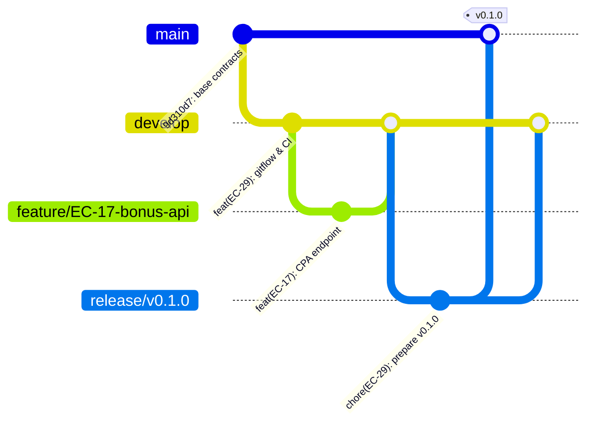

# Регламент работы с Git Flow в проекте EcoTrack

Рабочий процесс репозитория [`renchelbob/ecotrack`](https://github.com/renchelbob/ecotrack) построен по модели **Atlassian Gitflow** и синхронизирован с доской `EC` в Jira Cloud (`renchelbob.atlassian.net`).

---

## 1. Модель ветвления

В проекте используются две постоянные ветки с неограниченным сроком жизни и три типа временных поддерживающих веток:



| Тип ветки | Базовая ветка | Целевая ветка слияния | Шаблон имени | Срок жизни | Назначение |
| :--- | :--- | :--- | :--- | :--- | :--- |
| `main` | — | — | `main` | Постоянная | Стабильные релизные состояния. Каждое слияние маркируется SemVer-тегом `vX.Y.Z` |
| `develop` | `main` | `release/vX.Y.Z` | `develop` | Постоянная | Интеграционная ветка следующей версии; источник для всех `feature/*` |
| `feature/*` | `develop` | `develop` | `feature/EC-XX-<slug>` | До слияния PR | Разработка новой задачи из спринта |
| `bugfix/*` | `develop` или `release/*` | `develop` или `release/*` | `bugfix/EC-XX-<slug>` | До слияния PR | Исправление дефекта в разрабатываемой версии или стабилизируемом релизе |
| `release/*` | `develop` | `main` **и** `develop` | `release/vX.Y.Z` | До выпуска | Стабилизация версии, фиксация `CHANGELOG.md`, релизные проверки без новых фич |
| `hotfix/*` | `main` | `main` **и** `develop` | `hotfix/EC-XX-<slug>` | До закрытия инцидента | Срочное исправление дефекта в продакшен-релизе (патч-версия `vX.Y.(Z+1)`) |

---

## 2. Именование веток и коммитов

### 2.1 Правила именования веток
1. Префикс выбирается строго из списка: `feature/`, `bugfix/`, `release/`, `hotfix/`.
2. После префикса указывается ключ задачи Jira в формате `EC-<номер>` (заглавными буквами), далее краткое описание в `kebab-case` на английском языке без пробелов и кириллицы:
   - `feature/EC-17-bonus-cpa-ledger`
   - `feature/EC-21-offline-outbox-sync`
   - `bugfix/EC-28-mascot-layout-overflow`
   - `hotfix/EC-29-friend-code-length`
   - `release/v0.1.0`
3. *Примечание по унификации*: в раннем чек-листе Лабы №4 фигурировал шаблон `ECO-XX`; на этапе настройки репозитория и Jira он приведён к фактическому ключу проекта `EC-XX`. CI-проверка `Contracts & Config Gate` автоматически отклоняет Pull Request с несоответствующим именем ветки.

### 2.2 Сообщения коммитов (Conventional Commits)
Формат: `<type>(EC-XX): <краткое описание в повелительном наклонении>`

Допустимые типы:
- `feat` — новая функциональность продукта (`feat(EC-17): implement CPA coupon checkout`);
- `fix` — исправление ошибки (`fix(EC-21): handle SQLite WAL lock on reconnect`);
- `docs` — документация и регламенты (`docs(EC-29): add Git Flow workflow guide`);
- `ci` — пайплайны GitHub Actions и инфраструктура сборки (`ci(EC-29): add PostGIS smoke check`);
- `test` — контрактные, PBT и стресс-тесты (`test(EC-30): add double-spend barrier`);
- `refactor` / `chore` — рефакторинг или обслуживание без изменения бизнес-логики.

---

## 3. Порядок разработки, Pull Request и перекрёстного ревью

### 3.1 Жизненный цикл задачи
1. Участник переводит карточку `EC-XX` в Jira в колонку `In Progress` и обновляет локальный `develop`:
   ```bash
   git checkout develop
   git pull origin develop
   git checkout -b feature/EC-XX-short-slug
   ```
2. Разработка ведётся строго в зоне ответственности своей роли (согласно `AGENTS.md`). Каталог `/contracts/` запрещено изменять в обычном продуктовом PR — любые правки контрактов выносятся в отдельный `CONTRACT_RFC`.
3. Перед отправкой ветки на сервер разработчик запускает локальные проверки:
   - базовые контракты: `uv run --with pyyaml python scripts/verify_contracts.py`;
   - бэкенд: `ruff check`, `ruff format --check`, `basedpyright --level error`, `pytest`;
   - мобильный клиент: `dart format`, `flutter analyze --fatal-infos --fatal-warnings`, `flutter test`.
4. Разработчик открывает Pull Request в `develop` по шаблону `.github/PULL_REQUEST_TEMPLATE.md` и переводит задачу в Jira в `Review`.

### 3.2 Матрица перекрёстного code review
Каждый PR до слияния обязан получить минимум **1 одобрение (Approve)** от другого участника команды, не являющегося автором кода:

| Автор PR (роль) | Предпочтительный ревьюер (основной) | Резервный ревьюер | Фокус проверки |
| :--- | :--- | :--- | :--- |
| `Tech Lead` (бэкенд, PostGIS, CI/CD) | `Android Dev 1` или `PM / Team Lead` | `Android Dev 2 / QA` | Соответствие `openapi.yaml` и `schema.sql`, отсутствие секретов, SQL-параметризация |
| `Android Dev 1` (клиент, датчики, sync) | `Android Dev 2 / QA` | `Tech Lead` | BLoC-состояния, SQLite outbox, `import_lint`, чек-лист 152-ФЗ |
| `Android Dev 2 / QA` (витрина, статистика, тесты) | `Android Dev 1` | `Tech Lead` | UI по спецификации, обработка ошибок из `error_catalog.json`, отсутствие моков БД |
| `UI/UX Designer` (ассеты, вёрстка, экраны) | `Android Dev 2 / QA` | `Product Analyst` | Соответствие дизайн-токенам и экранам `screens/` |
| `Product Analyst` / `PM / Team Lead` (доки, конфиги, аналитика) | `Tech Lead` | `Android Dev 1` | Согласованность с уставом, WBS, Jira и контрактами |

### 3.3 Разрешение конфликтов и слияние
1. Если `develop` ушёл вперёд и GitHub показывает конфликты, **автор PR** обновляет свою ветку локально:
   ```bash
   git fetch origin
   git checkout feature/EC-XX-short-slug
   git merge origin/develop
   ```
   (Либо `git rebase origin/develop` с последующим `git push --force-with-lease` **только в свою** `feature/*` ветку — никогда в `develop` и `main`).
2. После прохождения всех 4 проверок CI и снятия замечаний PR вливается в `develop` кнопкой **Create a merge commit** (`--no-ff` история, сохраняющая контекст ветки), после чего временная ветка удаляется.

---

## 4. Релизный цикл и экстренные исправления

### 4.1 Выпуск релиза (`release/vX.Y.Z`)
1. При готовности спринтового инкремента `Tech Lead` или `PM / Team Lead` создаёт ветку от `develop`:
   ```bash
   git checkout develop && git pull origin develop
   git checkout -b release/v0.2.0
   ```
2. В `release/*` запрещено добавлять новые фичи. Разрешены только стабилизационные правки (`bugfix/EC-*`), обновление `CHANGELOG.md` и версии в `backend/pyproject.toml` / `mobile/pubspec.yaml`.
3. Открывается PR `release/v0.2.0` → `main`. После зелёного CI и ревью выполняется слияние в `main`.
4. **Обязательное обратное слияние**: ветка `release/v0.2.0` также вливается через PR обратно в `develop`, чтобы стабилизационные коммиты и `CHANGELOG.md` не потерялись, после чего `release/v0.2.0` удаляется.
5. На целевом коммите в `main` ставится аннотированный тег `v0.2.0`:
   ```bash
   git checkout main && git pull origin main
   git tag -a v0.2.0 -m "Release v0.2.0"
   git push origin v0.2.0
   ```
   Отправка тега автоматически запускает production CD-пайплайн.

### 4.2 Срочное исправление (`hotfix/EC-XX-*`)
1. При критической ошибке на `main` ветка создаётся **строго от `main`**:
   ```bash
   git checkout main && git pull origin main
   git checkout -b hotfix/EC-XX-short-slug
   ```
2. Исправление проходит CI и PR-ревью в `main`, получает патч-тег `vX.Y.(Z+1)`.
3. Та же ветка `hotfix/*` (либо её изменения после мержа) обязательно вливается через PR в `develop`, чтобы фикс попал в текущую разработку.

---

## 5. Правила защиты веток (`Branch Protection`)

На GitHub для веток `main` и `develop` включены следующие ограничения:
- Прямые пуши в `main` и `develop` закрыты; изменения принимаются только через Pull Request.
- Требуется минимум **1 одобряющее ревью** (`Dismiss stale pull request approvals when new commits are pushed`).
- Требуется разрешение всех комментариев в обсуждении PR (`Require conversation resolution before merging`).
- Требуется актуальность ветки относительно целевой (`Require branches to be up to date before merging`).
- Обязательные статус-чеки `EcoTrack CI`:
  1. `Contracts & Config Gate`
  2. `PostGIS 17 Schema Smoke`
  3. `Code Quality Gates`
  4. `Docker Runtime Build`
- Запрещены `force push` и удаление веток `main` / `develop`.
